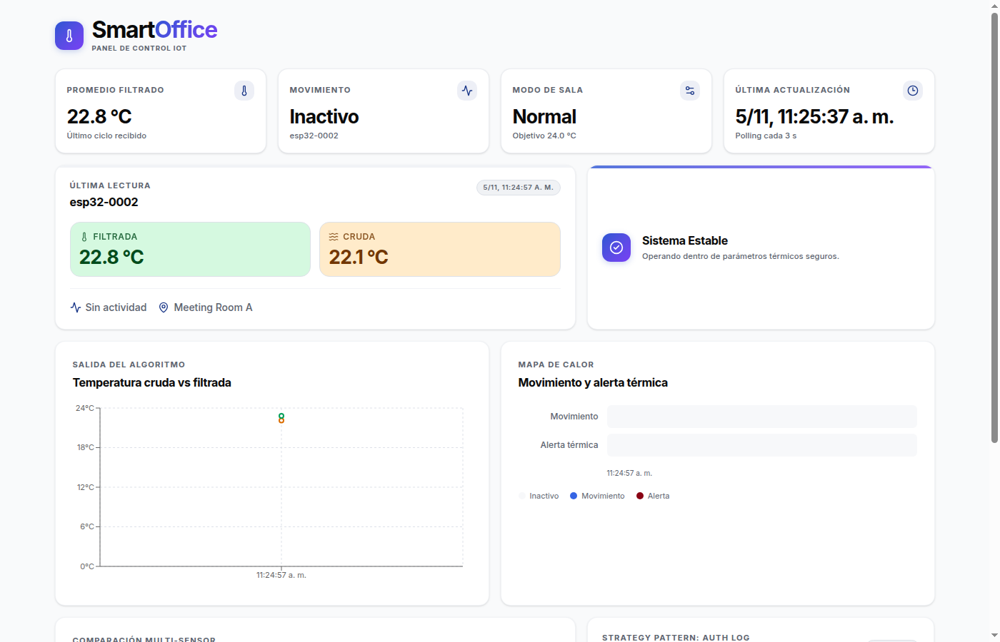
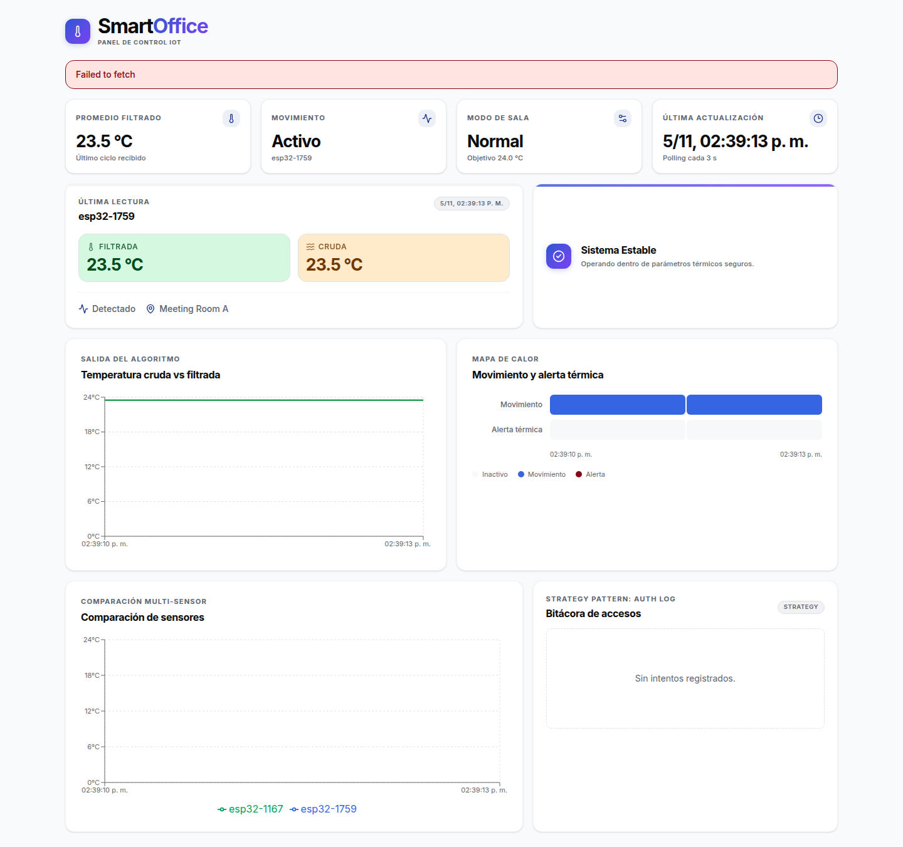
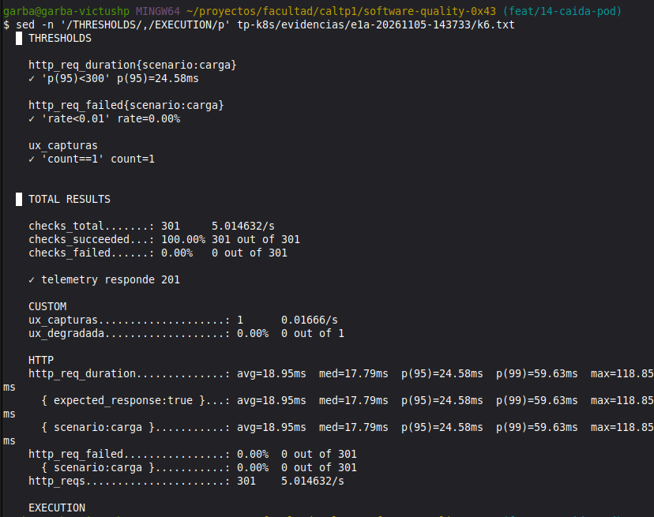
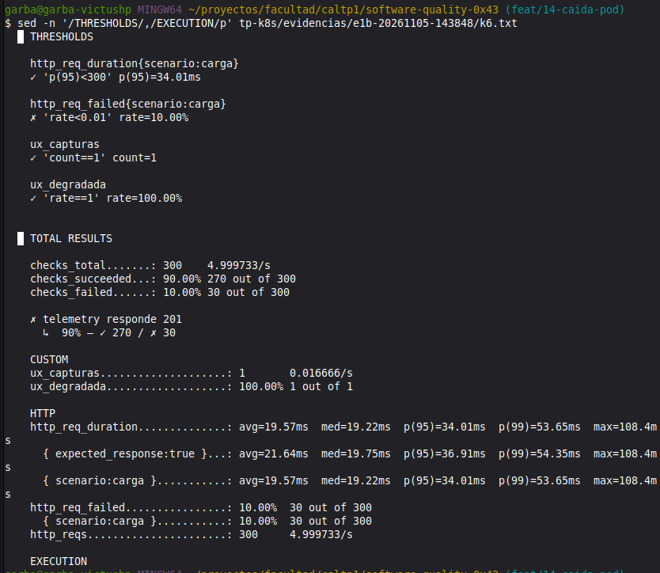

# TP4: Confiabilidad y resiliencia en Kubernetes (HPA + k6)

**Gestión de la Calidad del Software** · UNC - FCEFyN · 2026

Somos el equipo SRE de **TerraSense S.A.** El objetivo es migrar la plataforma IoT (ESP32 → API Flask → PostgreSQL, más el dashboard Next.js) desde Docker Compose a **Minikube**, sumarle autoescalado con HPA y someterla a pruebas de carga y de fallas. Con esa evidencia se da un veredicto **go / no-go** sobre si soporta **2.000 sensores reportando cada 30 s (≈ 67 req/s de escritura)**.

Seguimiento: issue general [#15](https://github.com/EnzoFernandezz11/software-quality-0x43/issues/15) con las sub-issues #11 a #14.

```text
tp-k8s/
|-- deploy.sh        # Levanta todo en un Minikube limpio
|-- k8s/             # Manifiestos (namespace, config, db, back, front, ingress, hpa…)
|   |-- examples/    # Plantillas que NO se aplican (Secret)
|   +-- monitoring/  # Prometheus + Grafana para k6 (opcional)
|-- k6/              # Scripts de pruebas de carga y fallas
|-- evidencias/      # Capturas de pantalla y salidas de k6 / kubectl
+-- README.md        # Este informe
```

---

## Arquitectura

```text
                 ┌──────── Minikube · namespace "terrasense" ─────────────────────────┐
                 │                                          HPA (#12)                 │
                 │                                             │ escala               │
 ESP32 / k6 ─────┼─► Ingress ── api.terrasense.local ──► Service back:5000 ─► Pods back ──SQL──► Service db:5432
 (POST /api/...) │   NGINX                                                            │          │
                 │     │                                                              │   StatefulSet db + PVC
 Navegador ──────┼─────┴───── terrasense.local ───────► Service front:3000 ─► Pod front │          ▲
 (HTTP)          │                                                                    │   Job db-migrate
                 └────────────────────────────────────────────────────────────────────┘
```

El dashboard es una **SPA**: sus componentes son `'use client'` y hacen `fetch` desde el **navegador del usuario**, que está fuera del clúster. Por eso no llama al back por el DNS interno de Kubernetes, sino a `http://api.terrasense.local/api` a través del Ingress. Next.js deja esa URL fija en el bundle al compilar, así que `deploy.sh` construye la imagen con `--build-arg NEXT_PUBLIC_API_URL=http://api.terrasense.local/api`.

| Manifiesto | Recursos | Notas |
|---|---|---|
| `00-namespace.yaml` | Namespace `terrasense` | Namespace dedicado al proyecto |
| `01-configmap.yaml` | ConfigMap `terrasense-config` | Host, puerto y nombre de la DB, modo de Flask, `GUNICORN_CMD_ARGS` |
| `examples/secret.example.yaml` | Secret `terrasense-secrets` (plantilla) | `deploy.sh` lo crea desde `.env`, así no se commitean credenciales |
| `10-db.yaml` | StatefulSet + Service `db` | PostgreSQL 16 con `volumeClaimTemplates` (PVC de 1 Gi) |
| `20-migrate-job.yaml` | Job `db-migrate` | `flask db upgrade` una vez por despliegue |
| `30-back.yaml` | Deployment + Service `back` (ClusterIP) | gunicorn, readiness/liveness, requests/limits, preStop |
| `40-front.yaml` | Deployment + Service `front` (ClusterIP) | Next.js standalone |
| `50-ingress.yaml` | Ingress `terrasense-ingress` | Plantilla del Anexo C |

---

## 1. Instrucciones de despliegue

### Requisitos

- Linux con **Docker** y **Minikube** (probado con Minikube v1.39 y driver docker). `kubectl` no hace falta porque se usa `minikube kubectl --`.
- **4 CPU y 6 GB de RAM libres** para el nodo, y unos 20 GB de disco para Docker.
- **k6** ≥ 1.0 para las pruebas. `k6/browser` necesita además Chromium o Google Chrome.

### Levantar todo

```bash
git clone git@github.com:EnzoFernandezz11/software-quality-0x43.git
cd software-quality-0x43
bash tp-k8s/deploy.sh
```

El script es idempotente y se puede volver a correr. Hace lo siguiente:

1. Verifica las herramientas. Si no existe `.env`, lo crea desde `.env.example`.
2. Crea el perfil de Minikube `terrasense` (4 CPU / 6 GB) y habilita los addons `ingress` y `metrics-server`.
3. Construye las imágenes `terrasense-back:local` y `terrasense-front:local` con el Docker del host y las carga en Minikube.
4. Crea el namespace, el ConfigMap y el Secret (este último desde `POSTGRES_USER`, `POSTGRES_PASSWORD` y `FLASK_SECRET_KEY` de `.env`).
5. Levanta PostgreSQL, corre las migraciones y después la API, el dashboard y el Ingress, esperando que cada paso quede listo. Si algo falla, imprime `describe`, logs y eventos.
6. Agrega `<minikube ip> api.terrasense.local terrasense.local` a `/etc/hosts` (pide `sudo` y deja una copia en `/etc/hosts.bak`).
7. Verifica `/health`, `/health/ready` y el dashboard **a través del Ingress**.

Variables opcionales:

| Variable | Default | Uso |
|---|---|---|
| `MINIKUBE_PROFILE` | `terrasense` | Nombre del perfil |
| `MINIKUBE_CPUS` / `MINIKUBE_MEMORY` | `4` / `6144` | Recursos del nodo; solo aplican al crear el perfil |
| `SKIP_BUILD=1` | — | Reusa las imágenes ya cargadas (despliegue rápido) |
| `SKIP_HOSTS=1` | — | No toca `/etc/hosts`; muestra el comando para hacerlo a mano |

### Verificar

```bash
alias k='minikube -p terrasense kubectl -- --context=terrasense -n terrasense'
k get pods,svc,ingress,pvc
k top pods                                   # metrics-server funcionando

curl http://api.terrasense.local/health        # {"status":"ok"}
curl http://api.terrasense.local/health/ready  # {"database":"up","status":"ok"}
curl -X POST http://api.terrasense.local/api/telemetry \
  -H 'Content-Type: application/json' \
  -d '{"sensor_id":"esp32-0001","raw_temperature":23.5,"motion_detected":true}'   # 201
```

En el navegador: dashboard en <http://terrasense.local> y Swagger en <http://api.terrasense.local/apidocs/>.

### Uso diario

```bash
minikube stop -p terrasense      # apaga el nodo y conserva la base (PVC)
minikube start -p terrasense     # lo vuelve a levantar; no hace falta redesplegar
bash tp-k8s/deploy.sh            # tras cambiar código: reconstruye y reinicia back/front
minikube delete -p terrasense    # borra TODO, incluidos los datos
```

Si cambia la IP del nodo (por ejemplo, después de `minikube delete`), volvé a correr `deploy.sh` para actualizar `/etc/hosts`.

### Problemas frecuentes

| Síntoma | Causa / solución |
|---|---|
| `ErrImageNeverPull` | La imagen no está en el nodo: correr `deploy.sh` sin `SKIP_BUILD` |
| `404` o `Connection refused` en `*.terrasense.local` | Falta el addon ingress, el Ingress no se aplicó o `/etc/hosts` apunta a otra IP (`minikube -p terrasense ip`) |
| `k top pods` dice `metrics not available yet` | metrics-server tarda alrededor de 1 minuto en juntar la primera muestra |
| Pod `back` en `Init:0/1` | Espera a que la DB acepte conexiones (`k logs deploy/back -c wait-db`) |

---

## 2. Decisiones de diseño (Actividad 1)

- **gunicorn en lugar del servidor de desarrollo de Flask.** `python main.py` levanta Werkzeug, que no está pensado para producción y daría mediciones poco representativas. En Kubernetes la API corre con `gunicorn main:app` y su configuración (workers, threads, timeouts) sale de `GUNICORN_CMD_ARGS` en el ConfigMap, así que se puede ajustar sin reconstruir la imagen. Docker Compose sigue usando el servidor de desarrollo.
- **Probes separadas por responsabilidad.**
  - `livenessProbe` → `GET /health`: no toca la base. Si PostgreSQL se pone lento, Kubernetes no reinicia todos los backs en cascada.
  - `readinessProbe` → `GET /health/ready`: hace `SELECT 1`. Si la DB no responde, el pod sale del balanceo pero no se reinicia.
  - Antes se usaba `/api/dashboard/history`, que hace un `count(*)` de toda la tabla cada 5 s por pod.
- **requests/limits en todos los contenedores.** Son indispensables para el HPA, que calcula el % de CPU sobre `requests.cpu`. El back arranca con `requests 100m/192Mi` y `limits 500m/384Mi` (perfil "nominal"); en reposo, con 2 workers de gunicorn, consume unos 138 Mi. #12 ajusta estos valores para el experimento E2.
- **ConfigMap vs Secret.** Lo no sensible va en el ConfigMap versionado. Usuario, contraseña y secret key van en un Secret que se genera desde `.env`, que no se commitea; en el repo queda solo una plantilla en `examples/`.
- **PostgreSQL como StatefulSet** (Anexo de la consigna), con `PGDATA` en un subdirectorio del volumen. Verificado: los datos sobreviven a `kubectl delete pod db-0`.
- **Reconexión a la DB** con `pool_pre_ping`. Mientras PostgreSQL se reinicia, los backs pasan a *not ready* y el Ingress responde 503. Cuando vuelve, no quedan conexiones muertas en el pool (ver Aprendizaje).
- **Cortes de servicio más suaves.** El back usa `RollingUpdate` con `maxUnavailable: 0` y un `preStop: sleep 5`, para que el Ingress saque el pod de sus endpoints antes de que gunicorn deje de aceptar conexiones. Esto incide directamente en el experimento E1.
- **Imagen del back más chica y sin root.** El Dockerfile copiaba todo el monorepo (front, firmware, reportes); ahora copia solo `backend/flask/final_project` y corre con un usuario sin privilegios.

---

## 3. Evidencia visual

**Despliegue (A1):** el dashboard servido por el Ingress (`http://terrasense.local`) muestra datos reales leídos desde la API (`http://api.terrasense.local`).



> _Pendiente: capturas de #12._

- [ ] `kubectl get hpa` escalando los pods bajo carga (#12)
- [ ] Evidencia del colapso: `OOMKilled` o `CrashLoopBackOff` (#12)
- [x] `falla-ux.png` generada por `k6/browser` durante la caída de la API (#14)

**E1b (#14):** captura automática del 2026-11-05 a las 14:39:16 (UTC−3).
El dashboard conserva las últimas lecturas y muestra «Failed to fetch» al perder la API.



En [E1a](evidencias/e1a-20261105-143733/ux.png) el dashboard siguió funcionando.
Las salidas de consola están en [E1a/k6.txt](evidencias/e1a-20261105-143733/k6.txt)
y [E1b/k6.txt](evidencias/e1b-20261105-143848/k6.txt); el análisis está en la sección 5.

**Consola E1a:** captura de la salida guardada de k6. Las 301 solicitudes
respondieron 201, sin errores, y el p95 fue 24,58 ms. Se cumplieron ambos SLOs
y el navegador no detectó degradación durante su observación.



**Consola E1b:** captura de la salida guardada de k6. Fallaron 30 de 300
solicitudes (10 %), incumpliendo el SLO de errores menor al 1 %. El p95 de
34,01 ms cumplió el objetivo de latencia. `ux_degradada = 100 %` corresponde
a la única observación del navegador, que detectó la falla.



---

## 4. Pruebas de carga (Actividad 3)

> _Pendiente: #13._

SLOs: `http_req_failed < 1 %` y p95 de `POST /api/telemetry` < 300 ms.

| Test | Carga | RPS | p95 | p99 | % error | Réplicas | ¿SLO? |
|---|---|---|---|---|---|---|---|
| Smoke | | | | | | | |
| Load (2.000 sensores) | 67 req/s | | | | | | |
| Stress | | | | | | | |

---

## 5. Análisis de resiliencia (Actividad 4)

### E1: caída de pods y experiencia del usuario (#14)

`k6/e1-falla.js` ejecuta dos escenarios: una carga constante de **5 POST/s** a
`/api/telemetry` por el Ingress y un VU de `k6/browser` que abre el dashboard al
momento de la falla. La carga baja busca aislar el efecto del borrado de pods;
no reemplaza el ensayo de capacidad de #13. Se conserva el perfil nominal de recursos.

Con el despliegue de la sección 1 funcionando, DNS local configurado y Chromium/Chrome
instalado (también se detecta Brave), ejecutar **una prueba por vez**:

```bash
bash tp-k8s/k6/e1.sh e1a  # borra un pod; exige al menos dos pods listos
bash tp-k8s/k6/e1.sh e1b  # borra todos los pods actuales del backend
```

Cada ejecución dura 60 s e inyecta la falla a los 20 s desde el inicio de los escenarios
de k6. El navegador tiene `startTime: 20s` y espera hasta 12 s por el mensaje de error
de la SPA; captura la pantalla al detectarlo o al vencer esa espera. No intercepta
requests ni altera la interfaz. En E1a, que la pantalla siga funcionando es un resultado
válido. En E1b, si no aparece una degradación visible, la ejecución lo informa y no
copia la captura a `evidencias/falla-ux.png`: se debe revisar el registro y repetir,
sin presentar una pantalla sana como evidencia de caída.

El orquestador usa `minikube -p terrasense kubectl -- --context=terrasense -n terrasense`.
No crea clústeres, modifica `/etc/hosts`, cambia réplicas ni desactiva el HPA. Si #12
ya está aplicada, registra su configuración; en E1b borra todos los pods encontrados
en el momento de la falla, independientemente del número de réplicas. El Deployment
los repone automáticamente. Se recomienda comprobar que el backend esté estable
antes de la siguiente ejecución.

Opciones para repetir el experimento:

```bash
RPS=5 DURATION_SECONDS=90 FAILURE_DELAY_SECONDS=20 UX_WAIT_SECONDS=12 \
  bash tp-k8s/k6/e1.sh e1b
# Si el navegador está fuera del PATH:
K6_BROWSER_EXECUTABLE_PATH=/ruta/a/chromium bash tp-k8s/k6/e1.sh e1a
# Con SKIP_HOSTS=1, resolver los dominios solo para curl/k6/navegador:
INGRESS_IP=$(minikube -p terrasense ip) bash tp-k8s/k6/e1.sh e1b
```

También acepta `MINIKUBE_PROFILE`, `BASE_URL`, `FRONT_URL`, `RUN_ID`,
`PRE_ALLOCATED_VUS` y `MAX_VUS`. Cambiar `BASE_URL` no cambia la URL de API que el
frontend tiene compilada. Las corridas agregan telemetría a la DB de prueba.

**Evidencias y medición.** Cada corrida crea un directorio nuevo
`evidencias/e1a-<fecha-hora>/` o `evidencias/e1b-<fecha-hora>/` con:

| Archivo | Contenido |
|---|---|
| `configuracion.txt`, `deployment.yaml`, `hpa.yaml` | Parámetros, versiones y configuración del backend/HPA |
| `falla.txt`, `pods.txt`, `endpoints.txt` | Borrado, evolución de pods e IPs listas/no listas del Service con timestamps |
| `k6.txt`, `requests.json`, `resumen-k6.json` | Consola, métricas por request y resumen de k6 |
| `medicion.txt`, `medicion.json` | Primer/último error, ventana en segundos, primer éxito posterior, p95 y SLOs de los POST |
| `ux.png` (E1a) / `falla-ux.png` (E1b) | Captura automática del dashboard |
| `recuperacion.txt`, `eventos.txt` | Estado del backend al terminar y eventos de Kubernetes |

La ventana pedida se calcula como **último error − primer error**, usando los timestamps
de finalización de los POST de k6; no incluye las solicitudes del navegador. Un solo
error produce una ventana de 0 s, no ausencia de falla. También se registra el primer
POST exitoso posterior al último error. Si no hay errores, se informa «sin errores
observados»; si no hay éxitos posteriores, la recuperación queda **sin observar** y la
ventana es parcial. Los registros de endpoints permiten contrastar cuándo salió la IP
del pod eliminado y cuándo apareció una IP lista de reemplazo; el Ingress puede tardar
algo más en actualizar su ruteo. Los watches tienen resolución de 1 s.
`dropped_iterations > 0` indica que no se mantuvo toda
la carga prevista. Los thresholds de k6 y la tabla general evalúan los POST de toda
la corrida: errores <1 % y p95 <300 ms. El análisis de E1b distingue además los
resultados dentro de la ventana de falla. k6 devuelve 99 si incumple thresholds;
las evidencias se conservan.

**Readiness y cierre.** La readiness (`/health/ready`, cada 5 s, dos fallos para retirar
un pod enfermo) evita enviar tráfico a pods que no llegan a la DB. En un borrado,
Kubernetes además marca el endpoint como terminando y lo retira de los destinos listos.
El `preStop: sleep 5` da tiempo a propagar ese cambio antes del SIGTERM; gunicorn tiene
20 s de cierre graceful dentro de los 30 s de gracia del pod. Esto puede ocultar por
completo E1a si el otro pod atiende las solicitudes. `e1.sh` usa `delete pod --wait=false`
y conserva esa terminación normal: no equivale a cortar el proceso con SIGKILL. La
estrategia `RollingUpdate/maxUnavailable: 0` regula despliegues, no garantiza disponibilidad
cuando se borran manualmente todos los pods en E1b.

**Resultados del 2026-11-05 (UTC−3).** Minikube v1.39.0, Kubernetes v1.37.0,
nodo con 4 CPU / 6 GiB, k6 v2.3.0 y Brave 156.1.98.63 como Chromium headless.
Dos réplicas iniciales, recursos nominales (`100m/192Mi` solicitados,
`500m/384Mi` de límite), sin HPA en esta rama basada en #11. Ambas pruebas usaron
5 POST/s durante 60 s, falla a los 20 s y cero iteraciones descartadas.
Se ejecutaron consecutivamente contra la DB de prueba recién desplegada, sin precarga.

| Prueba | Qué vio el usuario | Ventana de error (s) | Primer éxito posterior | Error (%) | p95 (ms) | ¿SLOs? |
|---|---|---|---|---|---|---|
| E1a | Dashboard operativo | Sin errores | No aplica | 0 (0/301) | 24,58 | Sí |
| E1b | Banner «Failed to fetch» y datos anteriores | 5,801 | 14:39:20,410 | 10 (30/300) | 34,02 | No: errores ≥1 % |

**E1a:** se borró `back-5f8f749ddf-2npbh` a las 14:37:54–55. Su IP
`10.244.0.10` salió de los endpoints listos a las 14:37:55; `10.244.0.9` quedó
atendiendo. El reemplazo (`10.244.0.12`) apareció listo a las 14:38:02. No hubo
errores de escritura ni mensaje de error en la captura. Los 7 s hasta que el reemplazo
quedó listo no constituyen una caída del servicio. Evidencia:
[medición](evidencias/e1a-20261105-143733/medicion.txt),
[pods](evidencias/e1a-20261105-143733/pods.txt) y
[endpoints](evidencias/e1a-20261105-143733/endpoints.txt).

**E1b:** se borraron ambos pods a las 14:39:10. El Service quedó sin endpoints
listos hasta las 14:39:17. El primer POST con 503 terminó a las **14:39:14,373671**;
el último, a las **14:39:20,174335**: diferencia **5,800664 s**. El primer 201
posterior terminó a las **14:39:20,409672** (≈3,4 s después de la aparición de
endpoints listos). La disponibilidad del Service y la recuperación observada por
Ingress/k6 no fueron simultáneas. El navegador capturó el banner a las 14:39:16,646,
dentro de esa ventana. El frontend no quedó en blanco: mantuvo las últimas lecturas,
pero dejó visible el error de comunicación. La recuperación fue automática, sin
escalado manual ni cambios de configuración. Se mantuvo el SLO de latencia, pero
los 30 errores 503 incumplieron el de errores; las respuestas 503 rápidas también
forman parte del p95, por lo que una latencia baja no demuestra disponibilidad.

**SLOs durante la ventana de falla:** al seleccionar en `requests.json` los POST
finalizados entre el primer y el último error (ambos incluidos), se obtienen
**30 solicitudes y 30 errores 503: 100 % de errores**, con **p95 de 1,61 ms**.
Dentro de esos **5,800664 s** se incumplió el SLO de errores y se cumplió el objetivo
de latencia por tratarse de respuestas de error rápidas. El **10 % de errores y
p95 de 34,02 ms** de la tabla corresponden a los **60 s completos**, que incluyen
también las 270 respuestas 201. Son dos intervalos de análisis de la misma corrida.

Evidencia: [medición](evidencias/e1b-20261105-143848/medicion.txt),
[borrado](evidencias/e1b-20261105-143848/falla.txt),
[endpoints](evidencias/e1b-20261105-143848/endpoints.txt) y
[estado final](evidencias/e1b-20261105-143848/recuperacion.txt).

Extracto de la salida real de E1b (`k6.txt`):

```text
http_req_failed................: 10.00%  30 out of 300
http_req_duration..............: avg=19.57ms  med=19.22ms  p(95)=34.01ms  p(99)=53.65ms  max=108.4ms
```

> E2 sigue pendiente de #12 en esta rama.

---

## 6. Veredicto go / no-go

> _Pendiente: #13._

---

## 7. Aprendizaje

Complicaciones que fuimos encontrando y cómo las resolvimos.

| Problema | Solución |
|---|---|
| `minikube image build --build-opt build-arg=…` no le pasa el build-arg al build cuando el runtime del nodo es containerd (en la práctica anterior hubo que sacarlo), y el front necesita la URL del Ingress al compilar | Se construye con el Docker del host (`docker build --build-arg`) y se carga en el nodo con `minikube image load` |
| La readinessProbe anterior consultaba `/api/dashboard/history`, que hace un `count(*)` de la tabla entera | Endpoints `/health` (sin DB) y `/health/ready` (`SELECT 1`) |
| La imagen del back copiaba todo el monorepo | `COPY` solo de `backend/flask/final_project` |
| **Después de reiniciar el pod de PostgreSQL, la API devolvía HTTP 500** en los primeros requests (`psycopg2.OperationalError: server closed the connection unexpectedly`). El pool de SQLAlchemy reusaba conexiones que habían muerto con el pod. Medido: 2 de 30 POST fallaron | `SQLALCHEMY_ENGINE_OPTIONS = {"pool_pre_ping": True}`: valida cada conexión antes de usarla y descarta las muertas. Repetido el experimento: 30 de 30 con 201 y 0 errores |

Prevenciones que aplicamos de entrada:

- `PGDATA` en un subdirectorio del volumen, porque `initdb` exige un directorio vacío y algunos provisioners crean `lost+found`.
- `deploy.sh` espera a que el `ingress-nginx-controller` esté listo antes de aplicar el Ingress; si no, el webhook de admisión puede rechazarlo.

---

## Herramientas adicionales

- `k6/seed-readings.sql`: carga lecturas sintéticas para que la tabla tenga un tamaño realista. Uso:
  ```bash
  k exec -i db-0 -- sh -c 'psql -U "$POSTGRES_USER" -d "$POSTGRES_DB" -v rows=50000' < tp-k8s/k6/seed-readings.sql
  ```
- `k8s/monitoring/` + `k6/run-in-cluster.sh`: Prometheus y Grafana para ver las métricas de k6. Corre los perfiles del `load-test.js` de la práctica anterior como Jobs dentro del clúster; los scripts del TP los define #13.
