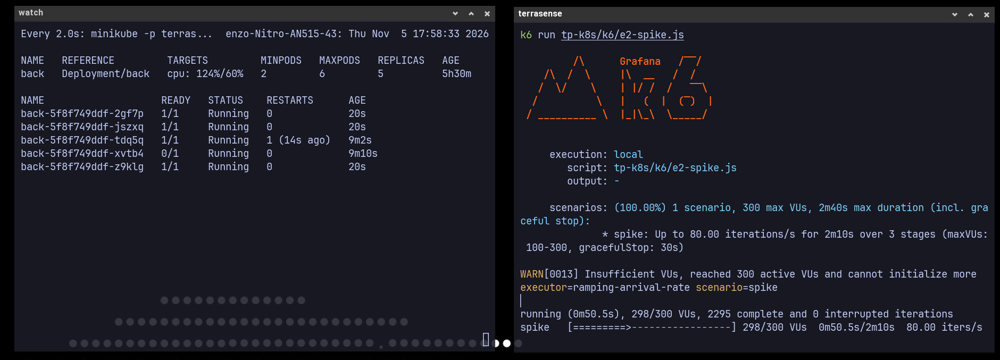
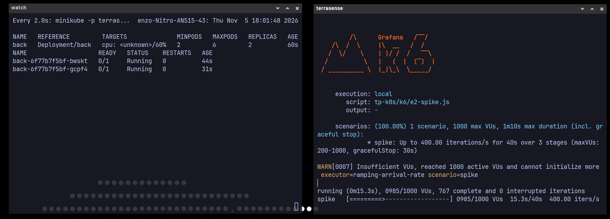
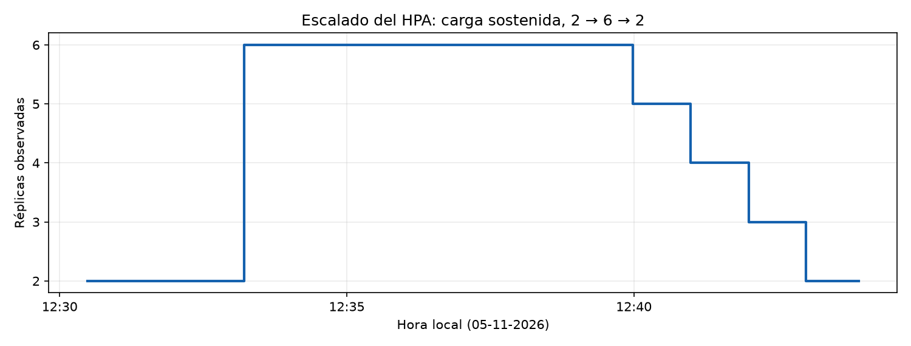
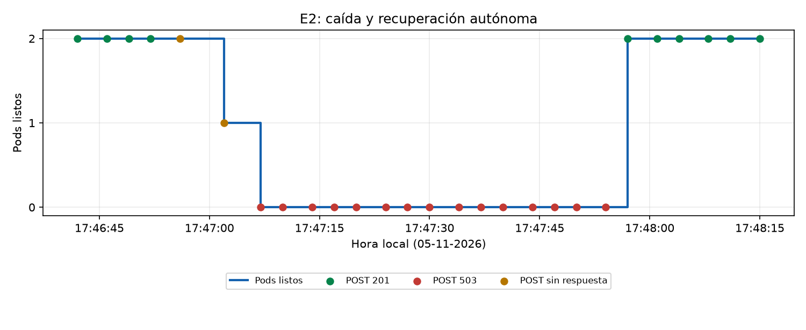

# TP4: Confiabilidad y resiliencia en Kubernetes (HPA + k6)

**Gestión de la Calidad del Software** · UNC - FCEFyN · 2026

Somos el equipo SRE de **TerraSense S.A.** El objetivo es migrar la plataforma IoT (ESP32 → API Flask → PostgreSQL, más el dashboard Next.js) desde Docker Compose a **Minikube**, sumarle autoescalado con HPA y someterla a pruebas de carga y de fallas. Con esa evidencia se da un veredicto **go / no-go** sobre si soporta **2.000 sensores reportando cada 30 s (≈ 67 req/s de escritura)**.

Seguimiento: issue general [#15](https://github.com/EnzoFernandezz11/software-quality-0x43/issues/15) con las sub-issues #11 a #14.

```text
tp-k8s/
|-- deploy.sh        # Levanta todo en un Minikube limpio
|-- k8s/             # Manifiestos (namespace, config, db, back, front, ingress, hpa…)
|   |-- examples/    # Plantillas que NO se aplican (Secret)
|   +-- monitoring/  # Prometheus + Grafana para k6 (opcional)
|-- k6/              # Scripts de pruebas de carga y fallas
|-- evidencias/      # Capturas de pantalla y salidas de k6 / kubectl
+-- README.md        # Este informe
```

---

## Arquitectura

```text
                 ┌──────── Minikube · namespace "terrasense" ─────────────────────────┐
                 │                                          HPA (#12)                 │
                 │                                             │ escala               │
 ESP32 / k6 ─────┼─► Ingress ── api.terrasense.local ──► Service back:5000 ─► Pods back ──SQL──► Service db:5432
 (POST /api/...) │   NGINX                                                            │          │
                 │     │                                                              │   StatefulSet db + PVC
 Navegador ──────┼─────┴───── terrasense.local ───────► Service front:3000 ─► Pod front │          ▲
 (HTTP)          │                                                                    │   Job db-migrate
                 └────────────────────────────────────────────────────────────────────┘
```

El dashboard es una **SPA**: sus componentes son `'use client'` y hacen `fetch` desde el **navegador del usuario**, que está fuera del clúster. Por eso no llama al back por el DNS interno de Kubernetes, sino a `http://api.terrasense.local/api` a través del Ingress. Next.js deja esa URL fija en el bundle al compilar, así que `deploy.sh` construye la imagen con `--build-arg NEXT_PUBLIC_API_URL=http://api.terrasense.local/api`.

| Manifiesto | Recursos | Notas |
|---|---|---|
| `00-namespace.yaml` | Namespace `terrasense` | Namespace dedicado al proyecto |
| `01-configmap.yaml` | ConfigMap `terrasense-config` | Host, puerto y nombre de la DB, modo de Flask, `GUNICORN_CMD_ARGS` |
| `examples/secret.example.yaml` | Secret `terrasense-secrets` (plantilla) | `deploy.sh` lo crea desde `.env`, así no se commitean credenciales |
| `10-db.yaml` | StatefulSet + Service `db` | PostgreSQL 16 con `volumeClaimTemplates` (PVC de 1 Gi) |
| `20-migrate-job.yaml` | Job `db-migrate` | `flask db upgrade` una vez por despliegue |
| `30-back.yaml` | Deployment + Service `back` (ClusterIP) | gunicorn, readiness/liveness, requests/limits, preStop |
| `40-front.yaml` | Deployment + Service `front` (ClusterIP) | Next.js standalone |
| `50-ingress.yaml` | Ingress `terrasense-ingress` | Plantilla del Anexo C |
| `60-hpa.yaml` | HPA `back` | Escala el Deployment del backend por CPU |

---

## 1. Instrucciones de despliegue

### Requisitos

- Linux con **Docker** y **Minikube** (probado con Minikube v1.39 y driver docker). `kubectl` no hace falta porque se usa `minikube kubectl --`.
- **4 CPU y 6 GB de RAM libres** para el nodo, y unos 20 GB de disco para Docker. Las mediciones de #12 se hicieron con 4 CPU y 4 GiB (`MINIKUBE_MEMORY=4096`), no con los 6 GiB predeterminados; #13 debe indicar y coordinar el entorno elegido antes de comparar resultados.
- **k6** ≥ 1.0 para las pruebas. `k6/browser` necesita además Chromium o Google Chrome.

### Levantar todo

```bash
git clone git@github.com:EnzoFernandezz11/software-quality-0x43.git
cd software-quality-0x43
bash tp-k8s/deploy.sh
```

El script es idempotente y se puede volver a correr. Hace lo siguiente:

1. Verifica las herramientas. Si no existe `.env`, lo crea desde `.env.example`.
2. Crea el perfil de Minikube `terrasense` (4 CPU / 6 GB) y habilita los addons `ingress` y `metrics-server`.
3. Construye las imágenes `terrasense-back:local` y `terrasense-front:local` con el Docker del host y las carga en Minikube.
4. Crea el namespace, el ConfigMap y el Secret (este último desde `POSTGRES_USER`, `POSTGRES_PASSWORD` y `FLASK_SECRET_KEY` de `.env`).
5. Levanta PostgreSQL, corre las migraciones y después la API, el dashboard y el Ingress, esperando que cada paso quede listo. Si algo falla, imprime `describe`, logs y eventos.
6. Agrega `<minikube ip> api.terrasense.local terrasense.local` a `/etc/hosts` (pide `sudo` y deja una copia en `/etc/hosts.bak`).
7. Verifica `/health`, `/health/ready` y el dashboard **a través del Ingress**.

Variables opcionales:

| Variable | Default | Uso |
|---|---|---|
| `MINIKUBE_PROFILE` | `terrasense` | Nombre del perfil |
| `MINIKUBE_CPUS` / `MINIKUBE_MEMORY` | `4` / `6144` | Recursos del nodo; solo aplican al crear el perfil |
| `SKIP_BUILD=1` | — | Reusa las imágenes ya cargadas (despliegue rápido) |
| `SKIP_HOSTS=1` | — | No toca `/etc/hosts`; muestra el comando para hacerlo a mano |

### Verificar

```bash
alias k='minikube -p terrasense kubectl -- --context=terrasense -n terrasense'
k get pods,svc,ingress,pvc
k top pods                                   # metrics-server funcionando

curl http://api.terrasense.local/health        # {"status":"ok"}
curl http://api.terrasense.local/health/ready  # {"database":"up","status":"ok"}
curl -X POST http://api.terrasense.local/api/telemetry \
  -H 'Content-Type: application/json' \
  -d '{"sensor_id":"esp32-0001","raw_temperature":23.5,"motion_detected":true}'   # 201
```

En el navegador: dashboard en <http://terrasense.local> y Swagger en <http://api.terrasense.local/apidocs/>.

### Uso diario

```bash
minikube stop -p terrasense      # apaga el nodo y conserva la base (PVC)
minikube start -p terrasense     # lo vuelve a levantar; no hace falta redesplegar
bash tp-k8s/deploy.sh            # tras cambiar código: reconstruye y reinicia back/front
minikube delete -p terrasense    # borra TODO, incluidos los datos
```

Si cambia la IP del nodo (por ejemplo, después de `minikube delete`), volvé a correr `deploy.sh` para actualizar `/etc/hosts`.

### Problemas frecuentes

| Síntoma | Causa / solución |
|---|---|
| `ErrImageNeverPull` | La imagen no está en el nodo: correr `deploy.sh` sin `SKIP_BUILD` |
| `404` o `Connection refused` en `*.terrasense.local` | Falta el addon ingress, el Ingress no se aplicó o `/etc/hosts` apunta a otra IP (`minikube -p terrasense ip`) |
| `k top pods` dice `metrics not available yet` | metrics-server tarda alrededor de 1 minuto en juntar la primera muestra |
| Pod `back` en `Init:0/1` | Espera a que la DB acepte conexiones (`k logs deploy/back -c wait-db`) |

---

## 2. Decisiones de diseño (Actividad 1)

- **gunicorn en lugar del servidor de desarrollo de Flask.** `python main.py` levanta Werkzeug, que no está pensado para producción y daría mediciones poco representativas. En Kubernetes la API corre con `gunicorn main:app` y su configuración (workers, threads, timeouts) sale de `GUNICORN_CMD_ARGS` en el ConfigMap, así que se puede ajustar sin reconstruir la imagen. Docker Compose sigue usando el servidor de desarrollo.
- **Probes separadas por responsabilidad.**
  - `livenessProbe` → `GET /health`: no toca la base. Si PostgreSQL se pone lento, Kubernetes no reinicia todos los backs en cascada.
  - `readinessProbe` → `GET /health/ready`: hace `SELECT 1`. Si la DB no responde, el pod sale del balanceo pero no se reinicia.
  - Antes se usaba `/api/dashboard/history`, que hace un `count(*)` de toda la tabla cada 5 s por pod.
- **requests/limits en todos los contenedores.** Son indispensables para el HPA, que calcula el % de CPU sobre `requests.cpu`. El back arranca con `requests 100m/192Mi` y `limits 500m/384Mi` (perfil "nominal"); en reposo, con 2 workers de gunicorn, consume unos 138 Mi. #12 ajusta estos valores para el experimento E2.
- **ConfigMap vs Secret.** Lo no sensible va en el ConfigMap versionado. Usuario, contraseña y secret key van en un Secret que se genera desde `.env`, que no se commitea; en el repo queda solo una plantilla en `examples/`.
- **PostgreSQL como StatefulSet** (Anexo de la consigna), con `PGDATA` en un subdirectorio del volumen. Verificado: los datos sobreviven a `kubectl delete pod db-0`.
- **Reconexión a la DB** con `pool_pre_ping`. Mientras PostgreSQL se reinicia, los backs pasan a *not ready* y el Ingress responde 503. Cuando vuelve, no quedan conexiones muertas en el pool (ver Aprendizaje).
- **Cortes de servicio más suaves.** El back usa `RollingUpdate` con `maxUnavailable: 0` y un `preStop: sleep 5`, para que el Ingress saque el pod de sus endpoints antes de que gunicorn deje de aceptar conexiones. Esto incide directamente en el experimento E1.
- **Imagen del back más chica y sin root.** El Dockerfile copiaba todo el monorepo (front, firmware, reportes); ahora copia solo `backend/flask/final_project` y corre con un usuario sin privilegios.

---

## 3. Evidencia visual

**Despliegue (A1):** el dashboard servido por el Ingress (`http://terrasense.local`) muestra datos reales leídos desde la API (`http://api.terrasense.local`).


> **Evidencia de #12:** [registro temporal del HPA y los pods](evidencias/hpa-experimento.txt), [salida de k6](evidencias/e2-recuperacion-k6.txt) y [estados durante el colapso](evidencias/e2-recuperacion-pods.txt). La falla observada fue la pérdida de readiness y el reinicio por liveness, no OOMKilled.
>
**HPA bajo carga:** 5 réplicas, CPU de 124 % frente al objetivo de 60 %, un pod no listo y un reinicio. k6 avisa que alcanzó el máximo de VUs y no puede generar toda la carga prevista.



**Colapso E2:** durante el pico de 400 iteraciones/s, los dos pods aparecen `0/1` y el HPA muestra CPU desconocida. k6 vuelve a avisar que agotó los VUs disponibles; la captura no muestra el resumen final de respuestas.



> **Pendiente #14:** `falla-ux.png` generada por k6/browser.

Los siguientes gráficos se generaron a partir de los registros anteriores; no son capturas de consola:





---

## 4. Pruebas de carga (Actividad 3)

> _Pendiente: #13._

SLOs: `http_req_failed < 1 %` y p95 de `POST /api/telemetry` < 300 ms.

| Test | Carga | RPS | p95 | p99 | % error | Réplicas | ¿SLO? |
|---|---|---|---|---|---|---|---|
| Smoke | | | | | | | |
| Load (2.000 sensores) | 67 req/s | | | | | | |
| Stress | | | | | | | |

---

## 5. Análisis de resiliencia (Actividad 4)

En la carga sostenida con el perfil nominal, el HPA pasó de 2 a 6 réplicas y luego volvió automáticamente a 2. Hubo fallas de readiness y liveness y reinicios; mientras los pods no estaban listos, el HPA no pudo calcular el uso de CPU. El 70,12 % de las 7.023 solicitudes completadas falló y el p95 fue 26,61 s. k6 descartó 2.976 iteraciones, por lo que no es una medición nominal válida para #13. Es una señal de riesgo que #13 debe investigar, no un veredicto go/no-go. La consulta `find_recent_with_motion` es una posible causa de carga y la liveness bajo saturación puede agravar la caída; no se demostró una causa única.

En E2 (4 CPU, 4 GiB, límites estresados de 250m/256Mi), el pico objetivo subió a 400 req/s en 5 s. De 11.137 solicitudes completadas, fallaron 10.345: **9.779 HTTP 503**, 1 HTTP 502 y 565 errores de transporte. El p95 fue 29,99 s; k6 descartó 2.862 iteraciones por falta de VUs, así que no logró generar toda la carga prevista. Los dos pods quedaron no listos y el HPA permaneció en 2; los 503 coinciden con la ausencia de pods listos. La prueba incumple los SLO sugeridos (<1 % de errores y p95 <300 ms), pero es deliberadamente estresada y no representa la carga nominal. Ver [resumen k6](evidencias/e2-recuperacion-k6.txt), [HPA](evidencias/e2-recuperacion-hpa.txt) y [pods](evidencias/e2-recuperacion-pods.txt).

La recuperación se observó **sin intervenir**: k6 terminó a las 17:47:35 y la primera muestra con ambos pods listos y POST 201 fue a las 17:47:57, aproximadamente **22 s después**; las muestras siguientes siguieron respondiendo 201. La sonda sondea cada ~3–5 s, por lo que el instante exacto tiene esa incertidumbre. Durante la falla Kubernetes reinició ambos contenedores; después de registrar la recuperación se restauró el perfil nominal. Ver el [registro de recuperación](evidencias/e2-recuperacion.jsonl) y [eventos](evidencias/e2-recuperacion-eventos.txt). E1 queda pendiente de #14.

---

## 6. Veredicto go / no-go

> _Pendiente: #13._

---

## 7. Aprendizaje

Complicaciones que fuimos encontrando y cómo las resolvimos.

| Problema | Solución |
|---|---|
| `minikube image build --build-opt build-arg=…` no le pasa el build-arg al build cuando el runtime del nodo es containerd (en la práctica anterior hubo que sacarlo), y el front necesita la URL del Ingress al compilar | Se construye con el Docker del host (`docker build --build-arg`) y se carga en el nodo con `minikube image load` |
| La readinessProbe anterior consultaba `/api/dashboard/history`, que hace un `count(*)` de la tabla entera | Endpoints `/health` (sin DB) y `/health/ready` (`SELECT 1`) |
| La imagen del back copiaba todo el monorepo | `COPY` solo de `backend/flask/final_project` |
| **Después de reiniciar el pod de PostgreSQL, la API devolvía HTTP 500** en los primeros requests (`psycopg2.OperationalError: server closed the connection unexpectedly`). El pool de SQLAlchemy reusaba conexiones que habían muerto con el pod. Medido: 2 de 30 POST fallaron | `SQLALCHEMY_ENGINE_OPTIONS = {"pool_pre_ping": True}`: valida cada conexión antes de usarla y descarta las muertas. Repetido el experimento: 30 de 30 con 201 y 0 errores |

Prevenciones que aplicamos de entrada:

- `PGDATA` en un subdirectorio del volumen, porque `initdb` exige un directorio vacío y algunos provisioners crean `lost+found`.
- `deploy.sh` espera a que el `ingress-nginx-controller` esté listo antes de aplicar el Ingress; si no, el webhook de admisión puede rechazarlo.

---

## Herramientas adicionales

- `k6/seed-readings.sql`: carga lecturas sintéticas para que la tabla tenga un tamaño realista. Uso:
  ```bash
  k exec -i db-0 -- sh -c 'psql -U "$POSTGRES_USER" -d "$POSTGRES_DB" -v rows=50000' < tp-k8s/k6/seed-readings.sql
  ```
- `k8s/monitoring/` + `k6/run-in-cluster.sh`: Prometheus y Grafana para ver las métricas de k6. Corre los perfiles del `load-test.js` de la práctica anterior como Jobs dentro del clúster; los scripts del TP los define #13.

---

## Apéndice: reproducir HPA, E2 y Grafana

El HPA mantiene de 2 a 6 pods y apunta al 60 % de la CPU solicitada (100m por pod en el perfil nominal). Dos réplicas permiten tolerar la caída de un pod; el máximo limita el consumo del Minikube propuesto. La subida no tiene ventana de estabilización y permite sumar hasta 4 pods cada 15 s; la bajada espera 300 s y quita como máximo un pod por minuto para evitar oscilaciones. Son valores iniciales, no una garantía de capacidad.

`deploy.sh` aplica el HPA. Para aplicarlo sin redesplegar, y observar métricas:

```bash
alias k='minikube -p terrasense kubectl -- --context=terrasense -n terrasense'
k apply -f tp-k8s/k8s/60-hpa.yaml
k top pods
k get hpa back
```

Esperar a que aparezcan métricas y que el HPA esté en 2 réplicas antes de cada prueba. En dos terminales registrar con fecha la evolución; detener con Ctrl+C después de observar también la bajada:

```bash
k get hpa back -w | while IFS= read -r line; do echo "$(date -Is) $line"; done | tee /tmp/hpa-watch-e2.txt
```

```bash
k get pods -l app=back -w | while IFS= read -r line; do echo "$(date -Is) $line"; done | tee /tmp/pods-watch-e2.txt
```

Para medir la recuperación sin intervenir, iniciar además un sondeo en otra terminal antes del pico y dejarlo hasta observar al menos tres POST 201 consecutivos con ambos pods listos. El intervalo real incluye el tiempo de cada comando; usar las marcas de tiempo para calcular el resultado. Cada POST agrega una lectura de prueba.

```bash
while true; do
  date -Is
  k get pods -l app=back
  curl --noproxy '*' --resolve "api.terrasense.local:80:$(minikube -p terrasense ip)" \
    -s -o /dev/null --max-time 2 -w 'POST: %{http_code}\n' \
    -H 'Content-Type: application/json' \
    -d '{"sensor_id":"recovery-probe","raw_temperature":23.5,"motion_detected":true}' \
    http://api.terrasense.local/api/telemetry
  sleep 3
done | tee /tmp/recuperacion-e2.txt
```

Primero comprobar la subida con carga sostenida y el perfil nominal (`requests: 100m/192Mi`, `limits: 500m/384Mi`). Aumentar `SPIKE_RPS` si la CPU no supera el objetivo; después de la carga, esperar al menos 5 minutos más el tiempo de reducción y comprobar que vuelve a 2 pods:

```bash
SPIKE_RPS=100 HOLD_DURATION=3m k6 run tp-k8s/k6/e2-spike.js 2>&1 | tee /tmp/hpa-carga.txt
```

Para E2, aplicar temporalmente el perfil estresado propuesto (`requests` sin cambios; `limits: 250m/256Mi`), esperar el rollout y volver a 2 pods antes de lanzar el pico. No modifica el manifiesto nominal. Los POST agregan datos a la base: usar una base de prueba y anotar cuántas lecturas había, sin borrar datos existentes. Si se usa `seed-readings.sql`, anotar cuántas filas se agregaron; sus fechas se distribuyen en el pasado y no equivalen a tener todas las filas dentro de los últimos 15 minutos.

```bash
k set resources deployment/back -c back --requests=cpu=100m,memory=192Mi --limits=cpu=250m,memory=256Mi
k rollout status deployment/back --timeout=300s
k get hpa back
date -Is | tee /tmp/spike-e2.txt
SPIKE_RPS=400 k6 run tp-k8s/k6/e2-spike.js 2>&1 | tee -a /tmp/spike-e2.txt
date -Is | tee -a /tmp/spike-e2.txt
k describe hpa back > /tmp/hpa-describe-e2.txt
k describe pods -l app=back > /tmp/pods-describe-e2.txt
k get events --sort-by=.metadata.creationTimestamp > /tmp/eventos-e2.txt
```

El pico sube en 5 s, se mantiene 30 s y baja en 5 s. Se pueden ajustar `SPIKE_RPS`, `RAMP_DURATION`, `HOLD_DURATION`, `DOWN_DURATION`, `PRE_ALLOCATED_VUS` y `MAX_VUS`. `BASE_URL` permite cambiar el origen de la API. Revisar `dropped_iterations`: si es distinto de cero, k6 no generó toda la carga prevista; aumentar VUs o usar otra máquina generadora. Los contadores separan 502, 503, 504, errores de transporte y otros códigos distintos de 201; los checks verifican respuestas 201; la prueba no establece thresholds porque busca observar fallas.

Si se desplegó con `SKIP_HOSTS=1`, agregar `INGRESS_IP=$(minikube -p terrasense ip)` al comando de k6 para resolver `api.terrasense.local` sin editar `/etc/hosts`.

### Ver cada prueba en Grafana

El monitoreo es opcional y consume recursos adicionales. Tras desplegar la aplicación, crear el dashboard y levantar Prometheus y Grafana:

```bash
k create configmap grafana-dashboards --from-file=k6.json=tp-k8s/k8s/monitoring/grafana-dashboard.json --dry-run=client -o yaml | k apply -f -
k apply -f tp-k8s/k8s/monitoring/monitoring.yaml
k rollout status deployment/prometheus --timeout=300s
k rollout status deployment/grafana --timeout=300s
```

Dejar abiertos estos túneles en dos terminales:

```bash
k port-forward svc/grafana 3001:3000
```

```bash
k port-forward svc/prometheus 9090:9090
```

Abrir <http://localhost:3001/d/k6-local>. El dashboard tiene filtros **Prueba** y **Ejecución**; CPU y memoria son del clúster y no se filtran por ejecución. Para enviar el spike que corre fuera del clúster a Prometheus, ejecutar:

```bash
RUN_ID="e2-$(date +%Y%m%d-%H%M%S)" \
K6_PROMETHEUS_RW_SERVER_URL=http://127.0.0.1:9090/api/v1/write \
K6_PROMETHEUS_RW_TREND_STATS='p(95),avg' \
SPIKE_RPS=400 k6 run -o experimental-prometheus-rw tp-k8s/k6/e2-spike.js
```

Seleccionar `e2-spike` y su ejecución en Grafana. Para que las futuras pruebas del TP (smoke, load, stress y E1) aparezcan separadas, enviarlas también con salida `experimental-prometheus-rw` y las etiquetas k6 `profile` y `run_id` diferentes para cada prueba y ejecución; por ejemplo `--tag profile=smoke --tag run_id=smoke-001`. Esto no implementa las pruebas pendientes de #13 y #14. El monitoreo guarda datos localmente en el pod de Prometheus: si se reemplaza, el historial puede perderse; guardar capturas para la entrega.

Si no se observa saturación antes de que haya nuevos pods listos, repetir desde 2 réplicas con más carga o límites diferentes y registrar cada configuración. Guardar capturas de HPA y pods durante el experimento; `describe pods` y eventos pueden perder detalles cuando los pods se reemplazan, así que recogerlos también durante la falla. Comparar el inicio del pico, la primera falla y los cambios de réplicas y disponibilidad para calcular los tiempos de reacción y recuperación. El colapso puede manifestarse con errores, timeouts o latencia, sin necesariamente producir OOMKilled.

Al terminar, restaurar el perfil nominal y esperar el rollout:

```bash
k set resources deployment/back -c back --requests=cpu=100m,memory=192Mi --limits=cpu=500m,memory=384Mi
k rollout status deployment/back --timeout=300s
```
